# MediVision AI — Intelligent Medical Imaging Copilot

> **Research & educational prototype — not a medical device. Not for clinical use.**

MediVision AI is a full-stack imaging copilot in which **every medical model is designed and trained by
this project on free public datasets**, inference runs **fully offline on CPU**, and the "Copilot" is a
**self-built clinical language engine — no LLM, no external AI API**. Total cost: zero.

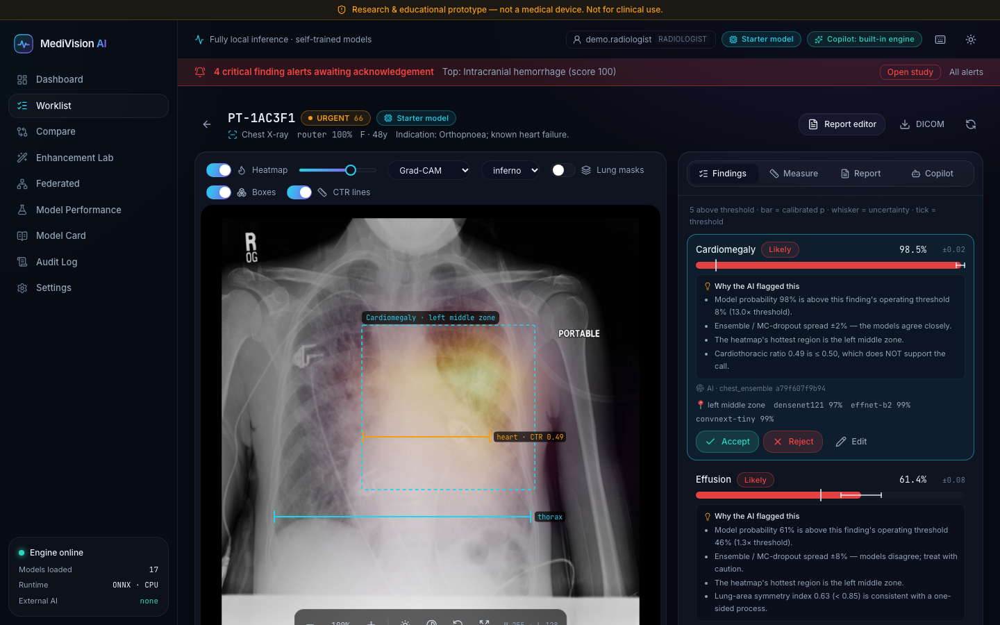

## What it does

| Paper section | Implemented as |
|---|---|
| III-A Diagnostic accuracy | Our DenseNet-121 + EfficientNet-B2 + ConvNeXt-Tiny **ensemble** for 14 chest findings (NIH ChestX-ray14); Faster R-CNN **fracture detector** + classifier (FracAtlas); 4-class **brain-tumour MRI classifier**; **head-CT hemorrhage** classifier; **3-D CNN for CT lung-nodule malignancy**; **breast-ultrasound** malignancy; **diabetic-retinopathy** grading on fundus photos. Every classifier reports sensitivity / specificity / FPR / FNR ("second-reader" table) |
| Modalities | X-ray · MRI · CT (head slices + chest-CT volumes) · ultrasound · fundus photography, routed by our 8-class modality router |
| III-C Segmentation | Our **U-Net** (lungs) and **Attention U-Net** (brain tumour); automatic **cardiothoracic ratio**, lung areas, symmetry, tumour area, **3-D nodule volumetrics** (volume, equivalent diameter, sphericity); heatmap peak → **lung zone** |
| III-D Triage | Urgency 0–100 from severity weights × calibrated exceedance × confidence (strongest finding + diminishing credit for others) → CRITICAL / URGENT / ROUTINE / NORMAL worklist; **critical-finding alerts** on every page until acknowledged; optional **autonomous mode** (pre-clears confident normals into a confirm queue — always human-confirmed) |
| III-E Reporting & NLP | **MediVision Copilot**: structured report writer (content selection → sentence planning → realisation with a phrase bank mined from IU X-ray), 22-intent chat with our intent model + BM25 knowledge base, streamed over SSE with UI action chips; rewrite as concise / detailed / patient-friendly; **experimental** CNN + Transformer report generator trained from scratch |
| III-F Advanced imaging | Our **DnCNN denoiser** trained on simulated low-dose noise, our **SR-GAN ×2 super-resolution** (experimental), CLAHE / unsharp / gamma, PSNR / SSIM; registered **image fusion**; **3-D view** (rotating MIP + MPR) for CT volumes |
| III-G Personalised | **Radiomics** (shape, first-order, GLCM) per study; **radiogenomics** study linking LGG tumour features to TCGA molecular clusters; longitudinal **compare** + **progression timeline** (per-finding trends, progression call); nodule / breast malignancy risk |
| IV Black box | **Grad-CAM, Grad-CAM++, occlusion** (3-D Grad-CAM for CT); **plain-language reasons** per finding; ensemble + **MC-dropout** uncertainty; per-label **temperature scaling** |
| IV Bias & data quality | **Fairness** by sex / age / view (chest) and sex / age / race (brain segmentation); class-imbalance losses; **modality router** + **energy-score OOD guard** |
| IV Privacy & security | **DICOM de-identification** + pseudonyms, **consent / lawful-basis** capture, **role-based access** (admin / radiologist / resident / viewer; optional token auth), local inference |
| IV Auditability & liability | **Hash-chained, tamper-evident audit log** (input hash, model versions, outputs, actor + role); per-finding AI-vs-human **provenance**; model **weights hash** on every result |
| IV Interoperability | DICOM / CT volumes in; **FHIR R4-style** DiagnosticReport, **PDF**, **DICOM Secondary Capture** + **DICOM Encapsulated PDF** out |
| V Federated learning | Real **FedAvg** across 3 simulated non-IID hospitals, live SSE charts, **per-site generalisation** (worst-site AUROC), HIPAA / GDPR notes |
| V Human–AI collaboration | Accept / reject / edit each finding; only radiologists sign; disagreements export as a **re-training CSV** |

A requirement-by-requirement audit against the source paper is in [docs/REQUIREMENTS_AUDIT.md](docs/REQUIREMENTS_AUDIT.md).

## Measured metrics (starter models, laptop-trained)

<!-- METRICS:START -->
| Model | Metric (held-out test) | Value | CPU ms/img (ONNX) |
|---|---|---|---|
| Chest X-ray ensemble (14 labels) | macro AUROC | 0.791 | — |
| · DenseNet-121 | macro AUROC | 0.769 | 7.3 |
| · EfficientNet-B2 | macro AUROC | 0.767 | 4.4 |
| · ConvNeXt-Tiny | macro AUROC | 0.786 | 9.6 |
| Lung U-Net | Dice | 0.974 | 19.2 |
| Fracture classifier | AUROC | 0.901 | 4.5 |
| Fracture detector | mAP@0.5 | 0.048 | — |
| Brain MRI classifier | accuracy / macro-F1 | 0.953 / 0.952 | 2.7 |
| Brain tumour Attention U-Net | Dice (tumour slices) | 0.752 | 5.4 |
| Modality router | accuracy / macro-F1 | 0.989 / 0.987 | 26.4 |
| DnCNN denoiser | PSNR noisy → ours (dB) | 22.9 → 32.8 | 7.9 |
| Report generator (experimental) | BLEU-4 / ROUGE-L | 0.095 / 0.248 | — |
| Copilot intent model | held-out accuracy | 0.964 | — |
| Head-CT hemorrhage classifier | AUROC · sens / spec | 0.995 · 0.95 / 0.95 | 4.4 |
| Chest-CT nodule malignancy (3-D CNN) | AUROC · sens / spec | 0.900 · 0.72 / 0.85 | 84.5 |
| Breast-ultrasound malignancy | AUROC · sens / spec | 0.907 · 0.64 / 0.95 | 2.9 |
| Diabetic-retinopathy grader (fundus) | referable AUROC · κ | 0.882 · 0.688 | 2.9 |
| Super-resolution x2 (SR-GAN) | PSNR bicubic → ours (dB) | 36.94 → 37.91 | 19.7 |
| Radiogenomics (LGG / TCGA) | targets above chance | 5/6 | — |
<!-- METRICS:END -->

Starter models are trained on small images for a few epochs on a laptop, so they are clearly weaker
than full models. Full-profile numbers appear in [docs/METRICS.md](docs/METRICS.md) and on the Lab page
after `make kaggle-train-all`. Full details, fairness tables and the federated run:
[docs/METRICS.md](docs/METRICS.md).

## Quick start

```bash
make setup            # Python 3.11 venv + requirements, npm install
make data-starter     # free datasets via MedMNIST+ and the Kaggle API (~/.kaggle token)
make train-starter    # trains, evaluates and exports EVERY starter model
make seed             # 12 demo studies, already analysed
make dev              # API http://localhost:8000/docs · UI http://localhost:3000
```
No API keys for any AI service are needed. After the downloads, everything works offline.
Upgrade to full accuracy on Kaggle's free GPU: [docs/TRAINING.md](docs/TRAINING.md).

Other commands: `make test`, `make lint`, `make e2e`, `make screenshots`, `make kaggle-train MODEL=brain_cls`,
`make docker` (see `make help`).

## Architecture

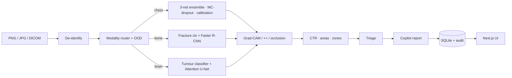
More in [docs/ARCHITECTURE.md](docs/ARCHITECTURE.md). Stack: PyTorch · timm · ONNX Runtime · FastAPI ·
SQLModel · scikit-learn · Next.js 15 · TypeScript · Tailwind · Radix · Framer Motion · Recharts ·
TanStack Query · zustand.

## Screenshots

| | |
|---|---|
| 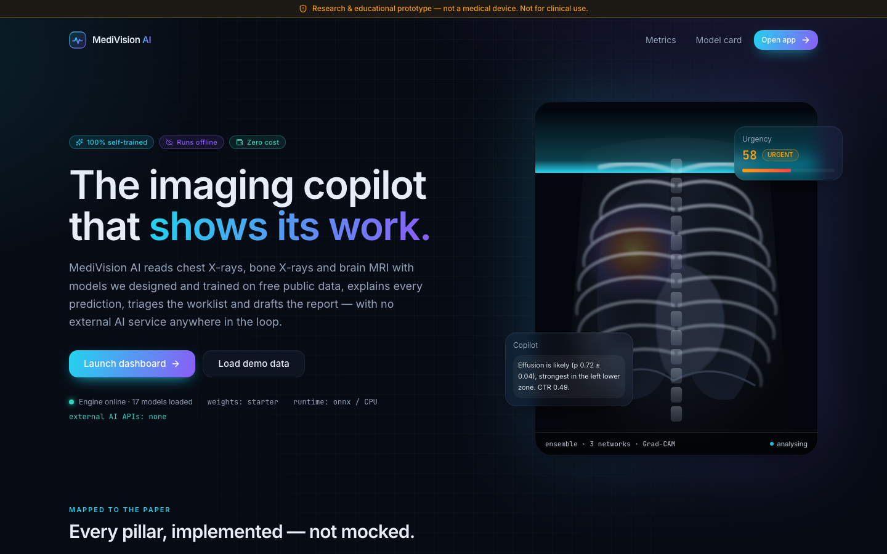 | 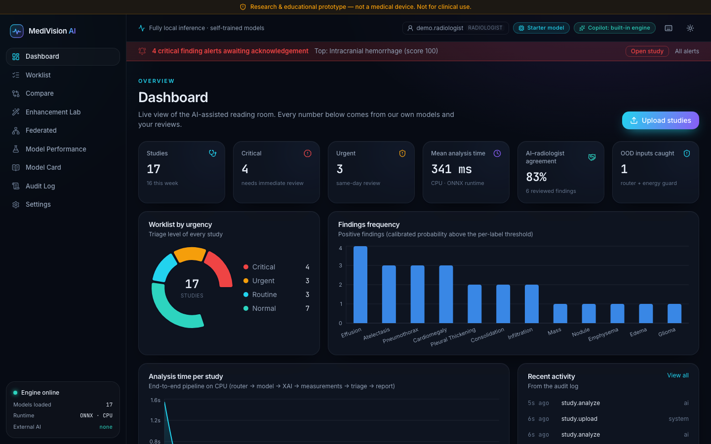 |
| 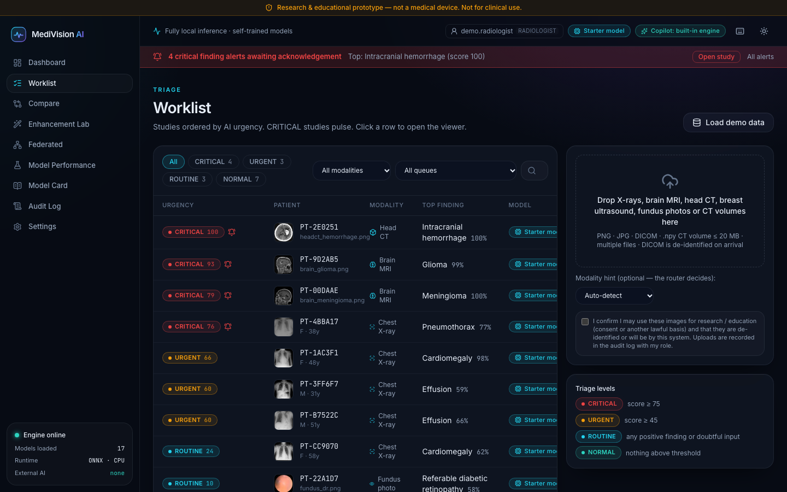 | 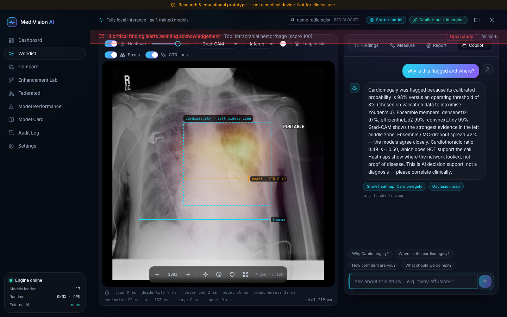 |
| 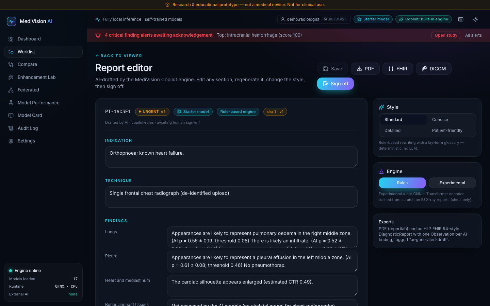 | 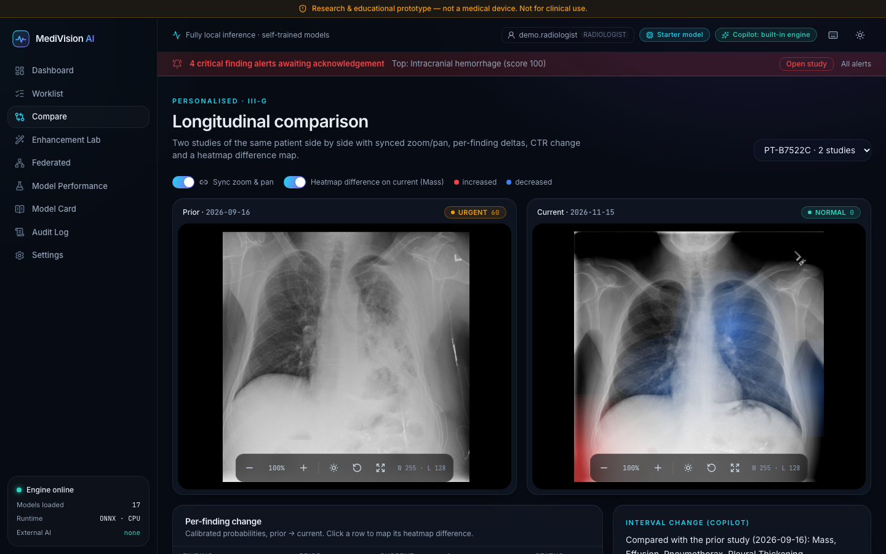 |
| 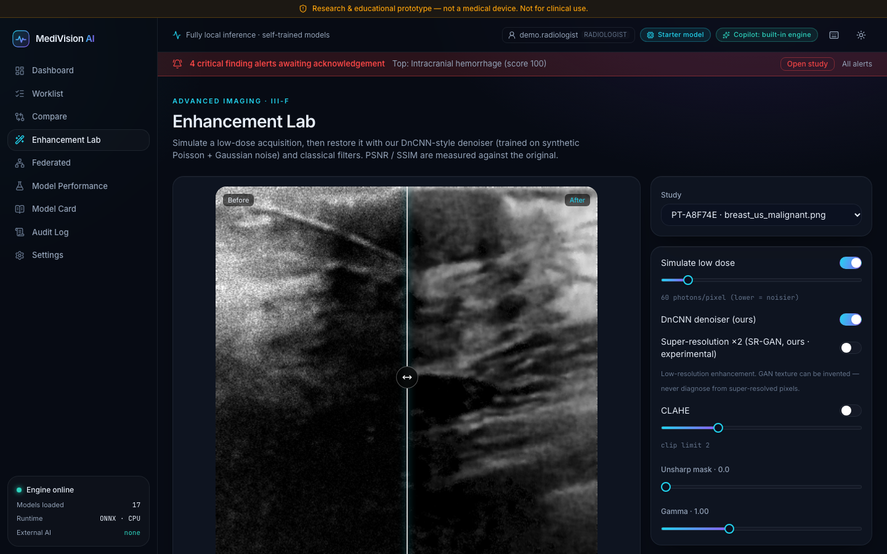 | 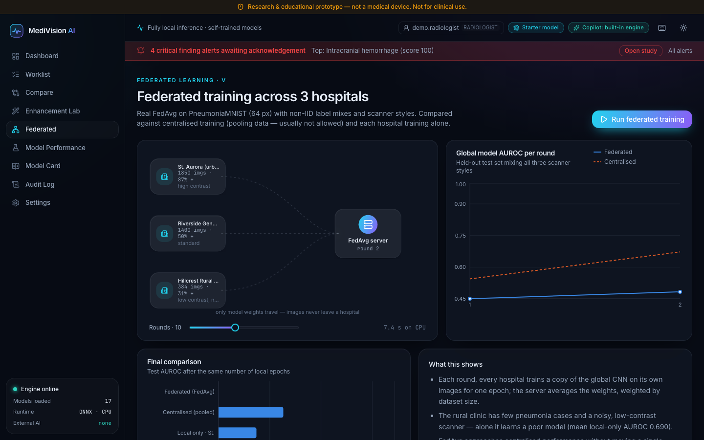 |
| 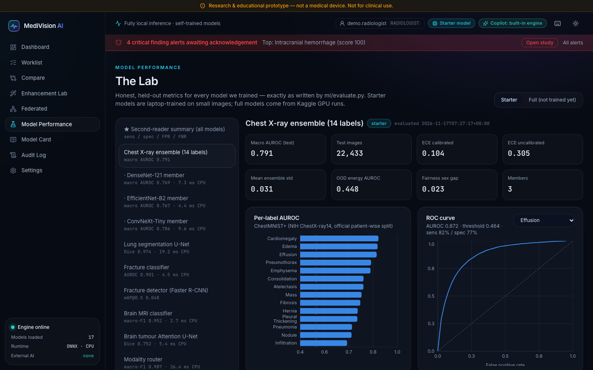 | 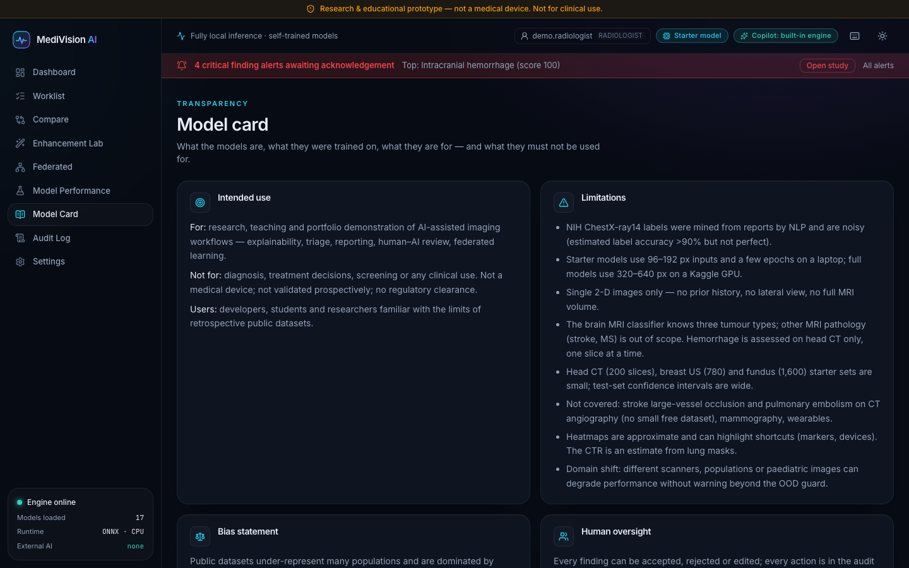 |

## Limitations

- Starter models: low resolution (96–192 px), subsets, few epochs → modest accuracy.
- NIH labels are NLP-mined and noisy; public datasets under-represent many populations and scanners.
- Single 2-D images; no clinical history; the brain model knows three tumour types only.
- Brain-MRI and lung-mask splits are random (no patient IDs published) — test scores may be optimistic.
- Heatmaps are approximate; the CTR is an estimate from segmentation masks.
- The chest ensemble's energy score is a weak OOD signal on its own (starter AUROC < 0.5 vs photos/MRI/bone); the
  modality router + grayscale check carry the OOD guard. Both are reported honestly in the Lab.
- The experimental report generator is small and can hallucinate; the rule-based report is the default.
- New-modality starter sets are small (head CT: 200 slices); CT nodules are characterised on supplied 64³
  patches, not detected in whole scans. Stroke LVO / PE, mammography and wearables are not covered.
- Radiomics / radiogenomics are exploratory; SR-GAN output is for viewing only.
- Auth is off by default (single-user demo); set `AUTH_ENABLED=true` for any shared deployment.

## Ethics

This is a research and teaching prototype. It must not be used to diagnose or treat anyone. All data are
public, de-identified research datasets used under their licenses; uploaded DICOMs are de-identified and
processed locally only. Every AI output is a draft for qualified human review, every action is audited,
and the Copilot never states a definitive diagnosis. See [docs/MODEL_CARD.md](docs/MODEL_CARD.md).

## Dataset credits

NIH ChestX-ray14 (Wang et al., CVPR 2017) · MedMNIST+ (Yang et al., Sci Data 2023) · FracAtlas (Abedeen et
al., Sci Data 2023) · Brain Tumor MRI (Nickparvar 2021) · LGG MRI Segmentation (Buda et al., CBM 2019) ·
Indiana University Chest X-rays / OpenI (Demner-Fushman et al., JAMIA 2016) · COVID-19 Radiography
Database (Chowdhury et al. 2020; Rahman et al. 2021) · RSNA Pneumonia (Shih et al. 2019) · CIFAR-10
(Krizhevsky 2009) · Head CT – hemorrhage (Kitamura 2018) · NoduleMNIST3D / LIDC-IDRI (Armato et al. 2011) ·
BreastMNIST / BUSI (Al-Dhabyani et al. 2020) · RetinaMNIST / DeepDRiD (Liu et al. 2022) · TCGA LGG clusters. Licenses: [docs/DATASETS.md](docs/DATASETS.md).

## Docs

[ARCHITECTURE](docs/ARCHITECTURE.md) · [DATASETS](docs/DATASETS.md) · [TRAINING](docs/TRAINING.md) ·
[MODEL_CARD](docs/MODEL_CARD.md) · [METRICS](docs/METRICS.md) · [API](docs/API.md) ·
[DEPLOYMENT](docs/DEPLOYMENT.md) · [DEMO_SCRIPT](docs/DEMO_SCRIPT.md) · [DECISIONS](docs/DECISIONS.md) ·
[PROGRESS](docs/PROGRESS.md)
